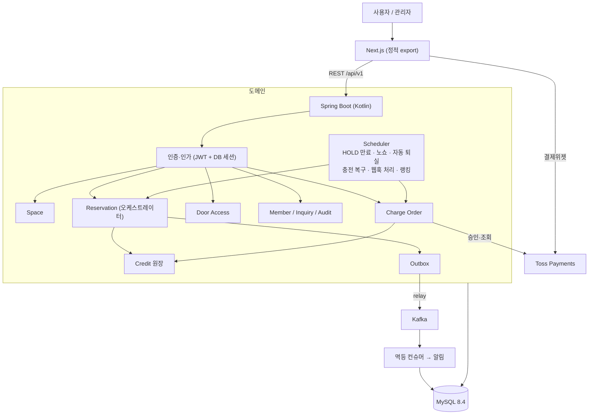
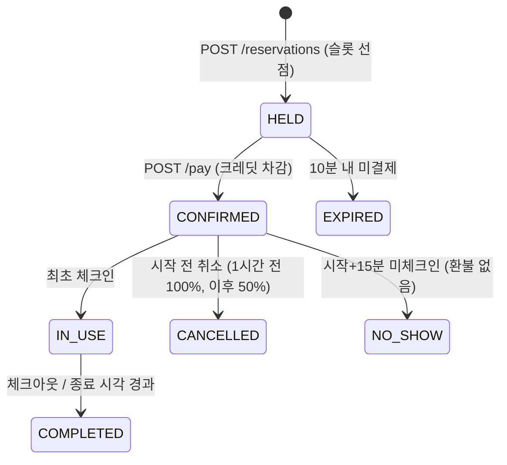

# 🔑 Slot Key

> 시간을 Slot으로 나누고, 예약한 Slot이 하나의 Key가 된다.

회의실·공유오피스를 **30분 단위로 예약**하고, 예약 상태와 이용 시간에 맞춰 **출입 권한(Mock Door)** 을 발급하는 서비스입니다. Kotlin · Spring Boot · MySQL · Next.js로 구현했고, 동시 예약 방지와 역할·소유권·상태·시간을 조합한 인가를 핵심 과제로 다뤘습니다.

| 항목 | 내용 |
| --- | --- |
| 팀 | 05팀 · 오벤져스 (백엔드 데브코스 12기 14회차) |
| 기간 | 2차 2026.09.14 ~ 10.01 (Java) · 3차 2026.10.22 ~ 10.29 (Kotlin 전환 계획은 10.28까지, 10.29 발표) |
| 저장소 성격 | 3차 저장소. 2차 Java 구현을 **기능 변경 없이** Kotlin으로 전환하고 PG 충전·대기열·알림을 확장 |
| API 문서 | 로컬 기동 후 `http://localhost:8080/swagger-ui/index.html` · [docs/api/api-spec.md](docs/api/api-spec.md) |
| 설계 기준 | [docs/core-domain-decisions.md](docs/core-domain-decisions.md) (다른 문서와 충돌하면 이 문서가 우선) |

## 🎯 무엇을 해결하는가

| 문제 | 해결 | 상세 |
| --- | --- | --- |
| 같은 시간대 동시 예약 | 슬롯 `UNIQUE(space_id, slot_start)` + 공간 비관적 락, 충돌 시 409 | [예약 동시성](docs/decisions/reservation-concurrency.md) |
| 예약 확정 중 일부만 성공 | 예약을 **HOLD(10분) → 결제** 2단계로 분리. 결제 실패 시 예약은 `HELD`로 남아 재시도 | [핵심 도메인 결정 §2](docs/core-domain-decisions.md) |
| 결제 요청 중복 | `Idempotency-Key`로 같은 요청은 최초 결과 재생 | [결제 멱등성](docs/decisions/reservation-idempotency.md) |
| 취소·종료 후에도 출입 가능 | 출입 검증마다 회원·소유권·예약 상태·토큰·시간을 재확인, 예약당 활성 토큰 1개를 DB 제약으로 강제 | [출입 키 정책](docs/decisions/access-key-policy.md) |
| 관리자 권한 남용 | 관리자도 타인 예약 취소·도어 토큰 발급 불가. `force-cancel`만 사유와 감사 로그로 허용 | [인가 정책](docs/decisions/authorization-policy.md) |
| 외부 PG 결과가 불확실 | 승인 API를 트랜잭션 밖에서 호출, 결과 모름은 `CONFIRMING`으로 두고 스케줄러가 조회 복구 | [PG 크레딧 충전](docs/decisions/pg-charge.md) |
| 빈자리·운영 알림 유실·중복 | 슬롯 해제·강제 취소·크레딧 지급·문의와 같은 트랜잭션에 Outbox 기록 → Kafka → 멱등 컨슈머 | [Outbox·Kafka](docs/decisions/outbox-kafka.md), [대기열](docs/decisions/waitlist.md), [알림 이벤트](docs/decisions/notification-events.md) |

## 🧩 기능

| 영역 | 기능 |
| --- | --- |
| 회원·인증 | 이메일 인증 가입(가입 크레딧 지급), JWT + DB 세션 로그인, Refresh Token 회전, 비밀번호 재설정, 탈퇴 |
| 공간 | 목록(지역·가격·시간 필터), 상세, 날짜별 30분 슬롯 조회, 베스트 공간 랭킹 |
| 예약 | HOLD → 결제 확정, 조회·취소(시작 전 환불 정책)·연장·체크아웃, 만료·노쇼·자동 퇴실 스케줄러 |
| 크레딧 | 예약 결제는 크레딧 원장 차감. 토스페이먼츠(sandbox)로 크레딧 충전, 웹훅 수신, 불명확 주문 자동 복구 |
| 출입 | 출입 키 발급·재발급·폐기, 모의 출입 검증(최초 체크인 / 재입장), 출입 기록 |
| 대기·알림 | 점유 구간 대기 신청, 슬롯 해제 시 대기자 전원 알림(선착순, 자동 승격 없음). 강제 취소·관리자 크레딧 지급·문의 답변 알림, 문의 등록 시 관리자 알림. 알림에서 해당 화면으로 이동 — Kafka 활성 환경 |
| 관리자 | 대시보드, 공간 등록·수정·사진 업로드, 회원 정지·복구·크레딧 지급, 전체 예약 조회·강제 취소, 감사 로그, 문의 답변 |
| 문의 | 회원 1:1 문의, 관리자 답변 |

**범위 밖**: 스마트락 하드웨어(Mock API로 대체), 예약 직접 카드 결제(크레딧 원장으로 단일화), 충전 환불·정기결제, 건물주별 격리 관리, 쿠폰·멤버십, 예약 시간 변경(취소 후 재예약), 대기 자동 승격, 소셜 로그인. 전체 목록은 [요구사항](docs/product/requirements.md).

## 🏗️ 아키텍처

단일 Spring Boot 모놀리스에서 도메인을 패키지로 나누고, Next.js 프론트와 REST(`/api/v1`)로 통신합니다. **오케스트레이션 방향은 `Reservation → Credit(원장)`** 이며 크레딧이 예약을 호출하지 않습니다. 별도 Payment 서비스는 없습니다.



상세: [시스템 아키텍처](docs/architecture/system-architecture.md) · [ERD](docs/architecture/erd.md) · [다이어그램 모음](docs/diagrams/)

### 예약 상태 전이



`EXPIRED` · `CANCELLED` · `COMPLETED` · `NO_SHOW`는 종단 상태입니다.

## ⚠️ 절대 깨지면 안 되는 규칙

1. **예약 단위는 30분**. `price_per_slot`은 30분당 정액(100원 단위). 시간당 요금 표현은 쓰지 않습니다.
2. **예약은 2단계**. 슬롯 충돌은 409(전체 롤백), 잔액 부족은 422 `INSUFFICIENT_BALANCE`, 홀드 만료 후 결제는 409(예약은 `HELD`로 남음).
3. **Access JWT 클레임은 `id`, `email`, `role`, `sid`**. 매 요청 DB 세션·회원 `ACTIVE`를 확인하므로 정지·탈퇴·로그아웃·비밀번호 재설정이 기존 토큰에 즉시 반영됩니다.
4. **관리자 권한 ≠ 소유권**. 타인 예약 취소·도어 토큰 발급 불가, 강제 취소는 `force-cancel` 경로만.
5. **예약당 활성 출입 토큰 1개**를 `active_reservation_id` + `UNIQUE`로 DB가 강제. 재발급 전 기존 토큰 폐기.
6. **`Idempotency-Key` 필수**: `POST /reservations/{id}/pay`, `POST /credits/charge-orders/confirm`.
7. **호출 방향은 Reservation → Credit**. 반대 방향 호출 금지.

## 📡 API 한눈에

Base URL `/api/v1`, 인증은 `Authorization: Bearer {accessToken}`(Refresh Token은 HttpOnly 쿠키). 전체 엔드포인트와 에러 코드는 [api-spec.md](docs/api/api-spec.md)와 Swagger UI를 기준으로 합니다.

| 영역 | 대표 엔드포인트 |
| --- | --- |
| 인증 | `POST /auth/signup` · `/auth/login` · `/auth/refresh` · `/auth/logout` · `/auth/withdraw` |
| 공간 | `GET /spaces` · `/spaces/{id}` · `/spaces/{id}/slots` |
| 예약 | `POST /reservations` → `POST /reservations/{id}/pay` · `/cancel` · `/extend` · `/check-out` |
| 출입 | `POST /reservations/{id}/door-token` · `POST /door-access/verify` |
| 충전 | `POST /credits/charge-orders` → `POST /credits/charge-orders/confirm` |
| 대기·알림 | `POST /waitlist` · `GET /notifications` |
| 관리자 | `/admin/spaces` · `/admin/members` · `/admin/reservations/{id}/force-cancel` · `/admin/audit-logs` · `/admin/inquiries` |

자주 보는 에러 코드: `RESERVATION_SLOT_CONFLICT`(409) · `RESERVATION_STATE_CONFLICT`(409) · `INSUFFICIENT_BALANCE`(422) · `FORBIDDEN_NOT_OWNER`(403) · `ACCOUNT_INACTIVE`(403) · `INVALID_ACCESS_TOKEN`(401)

## 🛠️ 기술 스택

| 영역 | 기술 |
| --- | --- |
| Backend | Kotlin 1.9.25, Java 21(JVM), Spring Boot 3.3.4, Spring Security 6, Spring Data JPA, JJWT |
| DB | MySQL 8.4, Flyway(V1~V27, `ddl-auto: none`) |
| 메시징 | Kafka + Outbox(compose 프로필 `kafka`, `SLOTKEY_KAFKA_ENABLED=true`일 때만 동작) |
| 결제 | 토스페이먼츠 sandbox (주문서형 결제위젯 SDK v2, Core API 승인·조회) |
| Frontend | Next.js 16 (App Router), React 19, TypeScript, Tailwind CSS |
| 품질 | JUnit 5, Mockito-Kotlin, Testcontainers(MySQL), ktlint, PIT 뮤테이션 테스트(수동) |
| 인프라 | AWS EC2(JAR + systemd) + RDS(MySQL) + S3/CloudFront, GitHub Actions |

## 🔄 3차: Kotlin 전환과 확장

2차 Java 구현을 **HTTP·메시지·DB 스키마를 바꾸지 않고** Kotlin으로 옮겼습니다. 현재 `backend/src`에 Java 파일은 없고 Kotlin이 main 296개 · test 219개입니다(2026-10-28, PR #246 병합 기준).

- **전환 규칙**: Kotlin 파일에 Lombok을 쓰지 않고, JPA 엔티티에는 `data class`를 쓰지 않습니다(`kotlin-jpa`, `allOpen` 사용). 같은 클래스의 `.java` 삭제와 `.kt` 추가는 한 커밋에 담습니다.
- **안전장치**: ktlint(위반 시 빌드 실패), CI 테스트 수 하한·스킵 0 검사, 전환 전 Java 응답을 저장해 비교하는 **골든 파일 테스트**.
- **확장**: PG 크레딧 충전, 예약 대기 + 빈자리 알림과 운영 알림 4종(Outbox → Kafka), 공간 랭킹, DB 세션 기반 인증 V2, PIT 뮤테이션 테스트.
- **운영 배포**: 전환 중에는 과금 문제로 EC2를 일시 중지했고, 전환 완료 후 재가동해 3차 JAR를 2차와 같은 EC2·RDS로 교체 배포했습니다(2026-10-28). 로그인·예약·충전·도어 토큰은 수동으로 확인했습니다. 같은 날 알림 이벤트 확장(Flyway V27, 토픽 `notification-events`)을 배포하고 운영 알림 동작을 수동으로 확인했습니다. 상세와 롤백(V27 이후 이전 JAR 롤백 주의)은 [배포·CI/CD](docs/operations/deploy-cicd.md#4-2-3차kotlin-교체-배포-2026-10-28)와 [§4-3](docs/operations/deploy-cicd.md#4-3-알림-이벤트-확장-배포-2026-10-28-pr-246)을 봅니다.
- 계획·일정: [Kotlin 전환 계획](docs/plans/kotlin-migration/README.md) · 결정: [Lombok 경계](docs/decisions/kotlin-lombok-boundary.md), [JPA 엔티티](docs/decisions/kotlin-jpa-entity-open.md), [data class 범위](docs/decisions/kotlin-data-class-scope.md), [ktlint](docs/decisions/kotlin-ktlint.md), [테스트 보호 장치](docs/decisions/kotlin-test-guardrails.md)

## 🧪 테스트

| 구분 | 내용 |
| --- | --- |
| 최신 전체 회귀 | 2026-10-28 PR #246(`dev` `1acfe15`와 같은 소스), `./gradlew ktlintCheck test`: **1,498개 테스트 통과**(실패·오류·스킵 0). 로컬 자기검증이며 CI도 통과 → [테스트 결과](docs/testing/test-results.md) |
| 동시성·멱등성 | 다중 스레드로 동일 슬롯 경합(1건만 성공), 만료-결제 경합, 같은 `Idempotency-Key` 재요청, 충전 승인 중복, 연장-신규 예약 경합 |
| 골든 테스트 | Java 구현 기준으로 저장한 주요 API 응답(JSON)과 Kotlin 전환 후 응답을 비교해 HTTP 계약 불변을 검증 → [골든 가이드](docs/testing/java-kotlin-golden-guide.md) |
| 시간 경계 | `Clock` 주입으로 체크인 시작·마감, HOLD 만료, 종료 직전·정각·직후를 고정 시각으로 검증 |
| 뮤테이션 | 핵심 도메인에 한해 PIT 수동 실행(`./gradlew pitest`), CI 미연결 → [결정](docs/decisions/mutation-testing.md) |
| 미검증 | E2E 브라우저 자동화, 운영 환경 Kafka 연동의 자동화된 측정(2026-10-28 수동 확인만), `SUM(credit_transaction) == member.balance` 전체 불변식 |

전략과 시나리오-테스트 대응표: [test-strategy.md](docs/testing/test-strategy.md)

## 🚀 로컬 실행

필요: JDK 21, Node.js 20.9+, Docker. 시크릿은 `.env`/환경변수로만 다루고 커밋하지 않습니다.

```bash
# 1) MySQL
cd backend && cp -n .env.example .env && docker compose up -d && cd ..

# 2) 백엔드 (Flyway 자동 마이그레이션). JWT_SECRET_KEY, 메일 설정 필요 → docs/operations/gmail-smtp-setup.md
cd backend && ./gradlew bootRun --args='--spring.profiles.active=local'
#    최초 1회 기동 후 종료하고, 샘플 데이터를 넣은 뒤 다시 기동합니다.

# 3) 샘플 데이터 (회원 100 · 관리자 1 · 공간 39)  — 저장소 루트에서
bash data-setting/setup.sh setup
#    관리자 admin000@sample.com / 일반 user001~100@sample.com, 비밀번호 00000000

# 4) 프론트엔드
cd frontend && npm install && npm run dev      # http://localhost:3000
```

- 토스 충전을 쓸 때만 `backend/.env`의 `TOSS_PAYMENTS_SECRET_KEY`, `frontend/.env.local`의 `NEXT_PUBLIC_TOSS_PAYMENTS_CLIENT_KEY`(둘 다 테스트 키)를 설정합니다.
- Kafka·알림은 compose 프로필 `kafka`와 `SLOTKEY_KAFKA_ENABLED=true`가 필요하며, 기본값에서는 알림이 생성되지 않습니다.
- 실행 오류는 [backend/README.md](backend/README.md), [트러블슈팅](docs/operations/troubleshooting.md).

```bash
# 테스트 (Testcontainers를 쓰므로 Docker 필요. 대규모 pull 뒤에는 clean 필수)
(cd backend && ./gradlew clean test)
(cd frontend && node --test tests/*.test.cjs && npm run lint && npx tsc --noEmit)
```

## 📚 문서 지도

| 알고 싶은 것 | 문서 |
| --- | --- |
| 서비스 범위·일정 | [requirements](docs/product/requirements.md) |
| **핵심 규칙(기준)** | [core-domain-decisions](docs/core-domain-decisions.md) |
| 구조·데이터 모델 | [system-architecture](docs/architecture/system-architecture.md) · [erd](docs/architecture/erd.md) |
| API·에러 코드 | [api-spec](docs/api/api-spec.md) · [결제 연동 계약](docs/api/FRONTEND2_PAYMENT_API.md) |
| 왜 그렇게 정했나 | [decisions/](docs/decisions/README.md) — 문제 → 대안 → 선택 → 검증 → 한계 |
| 흐름 그림 | [diagrams/](docs/diagrams/) — 슬롯 동시성, 결제 멱등성, 상태 전이, Outbox·Kafka |
| 배포·장애 | [deploy-cicd](docs/operations/deploy-cicd.md) · [troubleshooting](docs/operations/troubleshooting.md) |
| 계획 | [plans/](docs/plans/) — Kotlin 전환, 인증 고도화, 대기열·Outbox, 뮤테이션 테스트 |
| 전체 색인 | [docs/README.md](docs/README.md) |

## 🤝 협업 규칙

- 브랜치 `feat/* · refactor/* · test/* · docs/*` → **`dev`**(PR만) → `main`. 긴급 수정은 `hotfix/*`. **`dev` 머지는 곧 운영 배포**입니다(`DEPLOY_ENABLED`).
- 커밋 `type(scope): 영어 명령형 현재시제 문장` (scope는 도메인명). PR은 목적 1개, CI 통과 + 팀 리뷰 후 Squash and merge.
- Flyway는 push 전이면 기존 파일 수정, push 후면 새 파일을 만듭니다.
- 에이전트(Codex·Claude Code) 작업 규칙은 `AGENTS.md`를 따릅니다.

## 👥 팀

| 담당자 | 영역 |
| --- | --- |
| 김재철 ([@Lemnoideae](https://github.com/Lemnoideae)) | 공간 CRUD, 관리자 사진 업로드, 감사 로그 |
| 박창현 ([@pch112233456-a11y](https://github.com/pch112233456-a11y)) | 출입 키 발급·폐기, 모의 출입 검증 |
| 백한비 ([@jkidse14](https://github.com/jkidse14)) | 크레딧 원장, 예약 상태 이력 |
| 이태호 ([@anton061311](https://github.com/anton061311)) | 예약(HOLD 2단계·락·멱등성·연장·체크아웃), PG 크레딧 충전 |
| 천종원 ([@vvipia](https://github.com/vvipia)) | 회원·인증, 회원 정지/복구, 1:1 문의 |

3차 Kotlin 전환 담당은 [team-guide](docs/plans/kotlin-migration/team-guide.md)를 봅니다.
