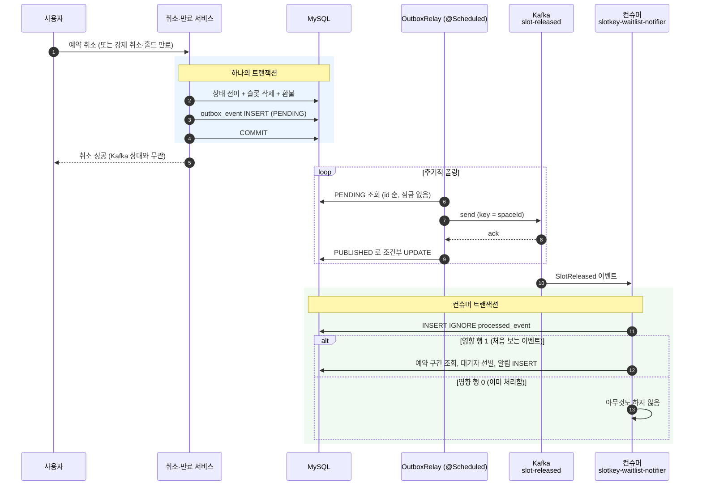
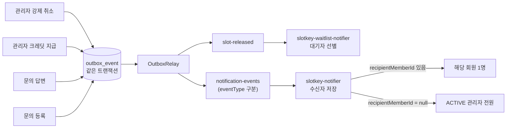
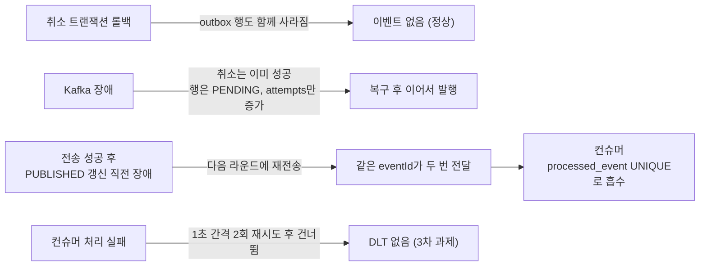

# Outbox + Kafka 이벤트 흐름 — 변경과 이벤트를 한 트랜잭션에, 효과는 한 번만

> **한 줄 메시지**: 슬롯이 풀리면 같은 트랜잭션에서 `outbox_event`에 기록하고, relay가 Kafka로 내보내며, 컨슈머가 중복을 걸러 알림을 저장한다. 전달은 최소 1회, 효과는 한 번이다.

## 정상 흐름

## 알림 이벤트 확장 (2026-10-28)

같은 Outbox·relay 위에 두 번째 토픽을 더했다. 보내는 쪽은 4곳이고 받는 쪽은 컨슈머 하나다. 근거는 [notification-events.md](../decisions/notification-events.md).

- 강제 취소는 두 토픽에 모두 이벤트를 남긴다. 빈자리(`slot-released`)와 예약자 알림(`notification-events`)이다.
- 두 컨슈머 모두 `processed_event`의 `UNIQUE(consumer, event_id)`로 중복을 흡수한다. 컨슈머 이름이 달라 서로 막지 않는다.

## 실패와 중복이 생기는 지점

## 왜 이렇게 했는가

- **Kafka로 직접 발행하지 않았다.** DB 커밋과 발행은 원자적이지 않아서, 커밋 뒤 발행이 실패하면 유실되고 트랜잭션 안에서 발행하면 롤백된 변경의 이벤트가 나간다(이중 쓰기).
- **전달은 최소 1회, 중복은 컨슈머가 흡수한다.** 정확히 한 번 전달을 만들려 하지 않고, `UNIQUE(consumer, event_id)`와 같은 트랜잭션의 `INSERT IGNORE`로 효과를 한 번으로 만든다.
- **`outbox_event`에는 FK를 걸지 않고, relay는 잠금 없이 폴링한다.** 취소·만료 트랜잭션과 락 대기가 생기면 이전에 겪은 Member/Space 데드락 경로가 다시 열리기 때문이다.
- **Kafka는 기본 꺼짐(`slotkey.kafka.enabled=false`)이다.** 브로커가 없는 팀 EC2 배포가 기동에 실패하지 않게 하려는 것이다.

## 한계

- 인스턴스 2개 이상이면 relay가 같은 행을 중복 발행한다(1개 가정).
- 계속 실패하는 행이 쌓이면 뒤의 새 이벤트가 막힌다(head-of-line). `FAILED` 상태·DLT·백오프는 3차 과제다.
- 건너뛴 이벤트는 로그에만 남고 복구 수단이 없다.

## 근거

| 내용 | 위치 |
| --- | --- |
| 기록(트랜잭션 필수) | `backend/src/main/java/com/ovengers/slotkey/outbox/SlotReleasedRecorder.java` |
| 폴링·발행 | `backend/src/main/java/com/ovengers/slotkey/outbox/OutboxRelay.java`, `KafkaOutboxPublisher.java` |
| 테이블 | `V18__create_outbox_event_table.sql`, `V19__create_processed_event_table.sql` |
| 컨슈머 설정 | `backend/src/main/java/com/ovengers/slotkey/notification/consumer/KafkaConsumerConfig.java` |
| 결정·검증 기록 | [`docs/decisions/outbox-kafka.md`](../decisions/outbox-kafka.md) (발행 지점 3곳, 타임아웃 불변식, 로컬 Kafka E2E 결과 포함) |

> 이 그림의 흐름과 한계는 위 결정 문서를 근거로 했다. `OutboxRelay`, `SlotReleasedRecorder`, `KafkaConsumerConfig` 소스는 직접 열어 보지 않았고, 컨슈머 리스너·핸들러 클래스 이름도 확인하지 못해 그림에서 "컨슈머"로만 표기했다.
