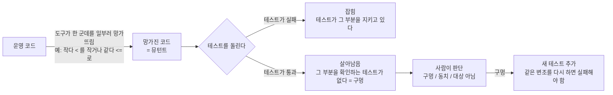
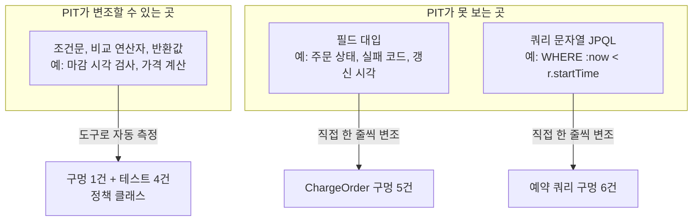
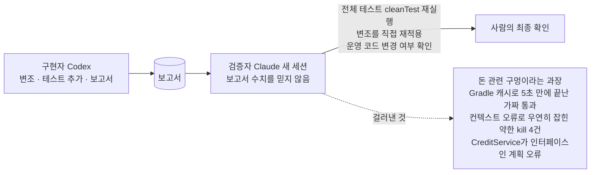

# 뮤테이션 테스트 발표·포트폴리오 구성안

> 작성: 2026-10-26. 결정 문서 [mutation-testing.md](../../../decisions/mutation-testing.md)의 §5 "최종 결과 요약"과 "면접·발표용 정리"를 슬라이드 순서로 재배열한 것이다. 수치와 사례는 새로 만들지 않았고 모두 결정 문서에서 가져왔다. 약어는 풀어 쓴다(뮤테이션 테스트 = 코드를 일부러 망가뜨려 테스트가 잡는지 보는 시험, PIT = 그 시험을 자동으로 해 주는 자바 도구).

## 한 문장 메시지

**"AI가 쓴 테스트가 통과한다고 믿을 수 있는지, 코드를 일부러 망가뜨려 직접 시험했고, 구멍 16개를 찾아 테스트 21개로 막았다."**

## 슬라이드 순서 (11장 기준)

| # | 제목 | 핵심 메시지 | 보여줄 것 |
| --- | --- | --- | --- |
| 1 | 문제: 초록불을 믿어도 되나 | AI가 쓰거나 Kotlin으로 옮긴 테스트가 "틀렸는데 통과"할 수 있다는 피드백을 받았다 | 테스트 1,300건이 전부 통과하는 화면 vs "그래서 믿을 만한가?" 질문 |
| 2 | 아이디어: 채점 로봇 시험하기 | 테스트는 채점 로봇이다. 정답지를 몰래 틀리게 바꿔 로봇이 알아채는지 본다 | 그림 A (아래) |
| 3 | 왜 커버리지로는 안 되나 | 라인 커버리지 100%여도 검사를 지워도 통과했다 | 사례 1의 코드 한 줄과 커버리지 100% 표시 |
| 4 | 방법: 어디에 어떻게 | 핵심 도메인(정책, 가격, 상태 전이, 크레딧)만, 단위 테스트로 22~43초. CI에는 넣지 않고 수동 실행 | 대상 클래스 표, 실행 시간 |
| 5 | 사례 1: 마감 시각 검사 | 종료가 마감을 넘어도 통과. "시작이 오픈 전"만 테스트하고 있었다 | 전/후 코드, 새 테스트 |
| 6 | PIT의 사각지대와 보완 | 필드 대입과 쿼리(JPQL)는 PIT가 못 바꾼다. 그래서 직접 20가지씩 바꿔 봤다 | 그림 B (아래) |
| 7 | 사례 2: 쿼리 속 규칙 | 노쇼·자동 체크아웃 쿼리의 `<`/`<=`를 바꿔도 기존 테스트가 통과. 서비스 테스트가 Repository를 mock으로 대체해 쿼리를 실행하지 않았다 | 전/후 쿼리, 변조 6건 결과 |
| 8 | 사례 3: 장부-예약 연결 | 환불·차감·위약금 장부가 어느 예약의 거래인지 연결되지 않아도 통과. 금액은 맞고 추적 정보가 비어 있었다 | 단언 전/후 |
| 9 | 구멍이 없던 곳도 결과다 | `DoorAccessTimePolicy` 16/16, `PricingService` 4/4, 돈 핵심(주문 상태, 잔액, 원장)은 탄탄 | 구멍이 있던 곳 vs 없던 곳 표 |
| 10 | AI 협업 검증 체계 | 구현(Codex)과 검증(Claude)을 분리. 검증자는 수치를 믿지 않고 재실행해 과장과 오류를 걸러냈다 | 그림 C (아래), 걸러낸 4가지 |
| 11 | 한계와 배운 점 | 개수는 심각도를 반영하지 않는다. 약한 kill 4건. 수동 변조는 재현성이 낮다. 점수 대신 사례로 설명한다 | 한계 표, 한 줄 결론 |

## 그림 A. 뮤테이션 테스트가 하는 일



## 그림 B. PIT가 보는 곳과 못 보는 곳



## 그림 C. AI 협업 검증 체계



## 대표 사례 3개: 전/후 (슬라이드 5, 7, 8용)

### 사례 1. 운영시간 마감 검사 (`ReservationTimePolicy.validate`)

```text
규칙: 예약 종료 시각이 운영 마감(22:00)을 넘으면 안 된다

기존 테스트:  "시작이 오픈(09:00) 전" 경우만 확인    (라인 커버리지 100%)
망가뜨림:     종료 시각 검사(!end.isAfter(closing))를 통째로 지움
결과:         테스트 전부 통과                      <- 구멍

추가한 테스트: 21:30 ~ 22:30 예약은 예외(INVALID_RESERVATION_TIME)
결과:         검사를 지우면 이 테스트가 실패
```

### 사례 2. 노쇼 쿼리의 경계 (`ReservationRepository.markNoShowIfNotCheckedIn`)

```text
쿼리:   ... WHERE r.status = :confirmed AND r.startTime < :limit
의미:   체크인 마감(start + 15분) "이후"에만 노쇼. 정각까지는 체크인할 수 있다

기존 테스트:  Repository를 mock으로 대체 -> 쿼리를 실행하지 않는다
망가뜨림:     < 를 <= 로 / status = 를 <> 로
결과:         기존 테스트 전부 통과                 <- 구멍 (노쇼 2건, 자동 체크아웃 2건, HELD 취소 2건)

추가한 테스트: 실제 MySQL에서 정각 / 1초 전 / 1초 후를 각각 확인
결과:         6건의 변조가 모두 새 테스트에서 실패
```

### 사례 3. 장부와 예약의 연결 (`CreditServiceImpl`)

```text
규칙: 차감·환불·위약금 장부는 "어느 예약의 거래인지"를 가리켜야 한다

기존 테스트:  장부의 금액, 종류, 잔액만 단언
망가뜨림:     장부에 예약을 null로 저장 (차감 / 환불 / 위약금 각각)
결과:         기존 테스트 전부 통과                 <- 구멍

추가한 테스트: 세 경로 각각에서 저장된 장부의 reservation이 요청한 예약과 같은 객체인지 확인
결과:         3건의 변조가 모두 새 테스트에서 실패
주의:         금액이 틀어지는 문제가 아니다. "추적 정보 유실" 구멍으로 설명한다
```

## 숫자 한 장 (결정 문서 §5 최종 요약과 동일)

| 항목 | 값 |
| --- | --- |
| 찾은 구멍 | 16개 |
| 추가한 테스트 | 21개 (직접 죽인 16 + 경계 고정용 5) |
| 정책 2개 + `PricingService` | 뮤턴트 43개 중 43개 잡힘 |
| `CreditServiceImpl` | 36개 중 28개 → 31개 |
| `DoorAccessTimePolicy` | 16개 중 16개 (구멍 없음) |
| 전체 테스트 | 175개 클래스, 1,322건, 실패 0 (`cleanTest`) |
| PIT 실행 시간 | 단위 테스트 한정 시 약 22~43초 |

## 발표 시 주의

- **과장하지 않는다.** 구멍 개수는 심각도를 반영하지 않는다. `ChargeOrder`의 구멍 5개는 보조 메타데이터(실패 코드, 복구 예약, 갱신 시각)이고 사례 3은 금액 오류가 아니다.
- **점수(%)를 앞세우지 않는다.** 점수 목표는 처음부터 두지 않았다. 사례와 개수로 말한다.
- **한계를 먼저 말한다.** PIT는 필드 대입과 쿼리를 못 바꾼다. 수동 변조는 재현성이 낮고, `SET status` 계열 4건은 단언이 아니라 컨텍스트 오류로 잡혔다.
- **AI가 한 일과 사람이 한 일을 구분한다.** 구현은 Codex, 검증은 Claude(새 세션), 최종 확인과 결정(범위, 유지·삭제, CI 여부)은 사람이다.

## 제작 도구

- 슬라이드로 옮길 때는 `devcourse-portfolio` 스킬(포트폴리오 PPT 섹션) 또는 `devcourse-deck` 스킬(발표 PPT)을 쓸 수 있다.
- 그림 A, B, C는 위 Mermaid 코드를 그대로 쓰거나 `portfolio-diagrams` 스킬로 다듬을 수 있다.
